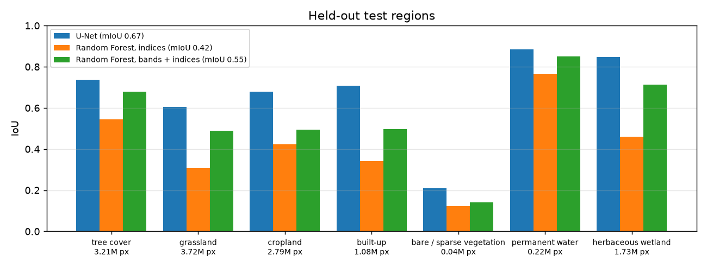
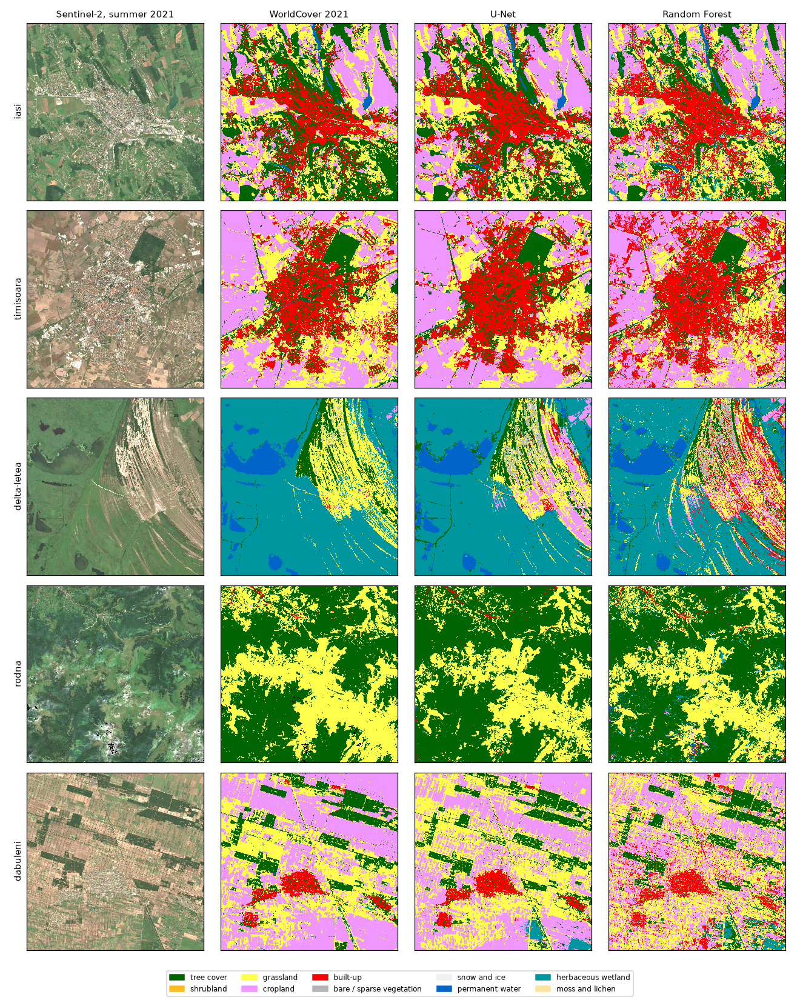

# Canopy

Land-cover maps of Romania from Sentinel-2. The pieces:

* **A U-Net in PyTorch.** It is trained on ESA WorldCover labels to segment ten classes.
* **A tile server in Rust.** It cuts the imagery into map tiles and runs the network on the fly.
* **A change API in Go.** It answers "what changed between two dates", for example forest lost or
  new buildings.
* **A web map in TypeScript (MapLibre).** It has a before/after slider.

```
canopy/       Python: data download, U-Net, training, Random Forest baselines, evaluation, change checks
tiles/        Rust: tile server (axum), U-Net inference with tract (pure Rust ONNX), UTM <-> lon/lat
change/       Go: change detection between two dates, patches as GeoJSON, overlay image
web/          TypeScript: MapLibre map, swipe between dates, change panel
regions.json  the study areas and their train / validation / test split
results/      evaluation.json, train_log.json, change_checks*.json (the numbers quoted below)
docs/         figures and the image chips used for the manual checks
models/       unet.onnx + norm.json (the trained network, as served)
```

## Data

* **Imagery: Sentinel-2 Level-2A.** It comes from the Earth Search STAC catalogue: Copernicus data
  as Cloud-Optimised GeoTIFFs on AWS, with no account or key. Only the window of each region is
  read.
* **Composites.** Each region and year gets two seasonal composites, spring (April–June) and
  summer (July–September). Each is the per-pixel median of three to eight of the clearest scenes,
  with clouds and shadows masked by the scene classification layer. More scenes are added while
  clouds leave holes. Ten bands each (B02–B08, B8A, B11, B12), so 20 channels, on a 10 m grid.
* **Labels: ESA WorldCover 2021 v200** (CC BY 4.0), resampled onto the same grid. Its ten
  classes, without mangroves, are:
  * tree cover
  * shrubland
  * grassland
  * cropland
  * built-up
  * bare / sparse vegetation
  * snow and ice
  * permanent water
  * herbaceous wetland
  * moss and lichen
* **Regions.** 15 areas of 16 × 16 km (1600 × 1600 pixels):
  * 8 for training: Cluj, Ploiești, Sfântu Gheorghe (Danube Delta), Retezat, Bărăgan, Maramureș,
    Brașov, Constanța;
  * 2 for validation: Oradea, Făgăraș;
  * 5 held out for testing, far from all of the above: Iași, Timișoara, Letea (Delta), Rodna,
    Dăbuleni.

  Four more areas are used only for change, 2019 against 2025: Pipera (north of Bucharest),
  Florești (west of Cluj), Bucovina and the Apuseni mountains. In all, 23 composites, 2.3 GB.
* **Download time.** `python -m canopy.data --labels` and the change years take about 30 minutes.

Two things in the data were worth knowing:

* **Zone boundaries.** Near the boundary between UTM zones 34 and 35, the Sentinel-2 tiles that
  cover a place can be in the neighbouring zone. The first download put Maramureș and Dăbuleni on
  a zone-35 grid with no scenes. Each region's grid now takes the projection of the scenes that
  actually cover it.
* **Missing classes.** Three of the ten classes barely occur in Romanian summers. In the training
  regions there are 291 shrubland pixels, 79 snow pixels and 6,779 moss-and-lichen pixels, against
  millions for the others. They cannot be learned or measured here. The mean IoU below therefore
  covers the seven classes with at least 10,000 pixels in the test regions, and says so.

## The network

* **Architecture.** A U-Net: four down-sampling levels, widths 32 to 512, 7.8 M parameters. It
  uses only ops that export cleanly to ONNX.
* **Input.** The 20 channels as standardised log reflectance.
* **Training.**
  * random 256 × 256 crops with flips and quarter turns;
  * cross-entropy weighted by the inverse square root of class frequency;
  * AdamW with a one-cycle schedule, 60 epochs of 800 crops;
  * mixed precision on an RTX 2060.

  It takes 15 minutes. The weights kept are those with the best validation mIoU (epoch 45,
  validation mIoU 0.51 including the near-absent classes, accuracy 85%).

## Results

### Per-class IoU on the held-out test regions

The test regions are Iași, Timișoara, Letea, Rodna and Dăbuleni: 12.8 M pixels the network never
saw. Two Random Forest baselines are trained on 20,000 pixels per class from the training regions:

* **indices**: NDVI, NDWI, MNDWI and NDBI per season (8 features);
* **bands + indices**: the 20 reflectances as well (28 features).

| class | test pixels | U-Net | RF, bands + indices | RF, indices |
|---|---:|---:|---:|---:|
| tree cover | 3,209,965 | **0.736** | 0.679 | 0.546 |
| grassland | 3,719,472 | **0.604** | 0.489 | 0.308 |
| cropland | 2,789,390 | **0.679** | 0.493 | 0.422 |
| built-up | 1,081,053 | **0.709** | 0.497 | 0.341 |
| bare / sparse vegetation | 37,619 | **0.209** | 0.142 | 0.122 |
| permanent water | 224,730 | **0.885** | 0.850 | 0.767 |
| herbaceous wetland | 1,728,250 | **0.847** | 0.712 | 0.459 |
| **mean IoU (these 7)** | | **0.667** | 0.552 | 0.423 |
| pixel accuracy | | **81.9%** | 71.8% | 58.2% |
| shrubland, snow, moss | 217 in all | not measurable | | |



Mean IoU per test region:

| | Iași | Timișoara | Letea | Rodna | Dăbuleni |
|---|---:|---:|---:|---:|---:|
| U-Net | 0.710 | 0.704 | 0.612 | 0.769 | 0.664 |
| RF, bands + indices | 0.657 | 0.575 | 0.517 | 0.767 | 0.419 |
| RF, indices | 0.565 | 0.489 | 0.425 | 0.492 | 0.303 |

* **Where the U-Net gains.** It gains most where the context around a pixel matters: built-up
  (+0.21 IoU over the better forest), cropland (+0.19) and wetland (+0.14). In the mountains
  (Rodna), where forest against grassland is a per-pixel spectral question, the Random Forest with
  all bands does as well.
* **Spectral indices alone** lose much: four normalised differences cannot separate grassland from
  cropland, or built-up from bare ground.
* **The labels are imperfect.** WorldCover is a map, not ground truth. ESA's validation puts its overall
  accuracy at about 77% worldwide, and grassland against cropland is among its most confused
  pairs. So these
  IoUs measure agreement with WorldCover. Some "errors" in the figure, such as field boundaries and
  hedges, are the U-Net drawing what the image shows.



### Change detection, checked by hand

The change API compares the U-Net's maps of two dates (2019 and 2025 here):

* **Deforestation:** tree cover becoming shrubland, grassland, cropland or bare ground.
* **Construction:** anything becoming built-up.

Changed pixels go through a 3 × 3 morphological opening, which removes one-pixel slivers along
edges, and are then grouped into connected patches of at least 0.5 ha.

To measure precision, I (Claude, the AI assistant that wrote this project) took random samples of the reported patches in the four change regions. I
looked at each one before and after, in Sentinel-2 true colour, and labelled it yes / no / unclear
with a note. The chips are in `docs/change_checks*/` and the labels in `results/change_checks*.json`.
These labels come from looking at 10 m imagery. There were no field visits or aerial photos, so
small or ambiguous cases are marked "unclear" and left out of the shares.

| check | sample | real | not real | unclear | precision (95% CI) |
|---|---:|---:|---:|---:|---|
| construction (class change only) | 40 | 28 | 7 | 5 | **80%** (64–90%) |
| deforestation, class change only | 40 | 5 | 29 | 6 | 15% (6–30%) |
| deforestation, with an NBR check | 40 (new sample) | 19 | 13 | 8 | **59%** (42–74%) |
| unreported sharp NDVI drops | 24 | 5 missed changes | 15 | 4 | 25% (11–47%) were real misses |

* **Construction works.** The detector finds new housing estates, warehouses and building sites,
  and the misses are mostly patches at the edge of something that already existed.
* **Deforestation from class maps alone did not work.** Most patches were forest that is still
  standing. Two composites differ in season and haze, and that is enough to flip a class at forest
  edges and in parks.
* **The NBR check.** A deforestation pixel now also needs the summer normalised burn ratio,
  (B08 − B12)/(B08 + B12), to drop by at least 0.1. Cutting a forest removes the near-infrared
  signal of the canopy and exposes soil and slash. The 0.1 threshold is a common one in the
  literature, fixed before looking at the checks. The improved detector was then checked on a
  **fresh** random sample, not on the 40 patches used to find the problem.
* **The NBR check's results.** Precision rose from 15% to 59%. Reported deforestation fell from
  1,100 ha to 290 ha across the four regions. In the mountains (Bucovina, Apuseni) 13 of 17 judged
  patches are real clear-cuts. Most of the remaining false positives are in Pipera. Băneasa forest
  is standing there, but its canopy was brown in summer 2025 (drought stress or defoliation), which
  also lowers NBR. A third date would separate a cut (stays bare) from stress (recovers).
* **Misses.** Among places where NDVI fell sharply but nothing was reported, a quarter were real
  changes the detector missed. They were mostly new streets and plots laid out on fields, which
  are bare ground rather than "built-up" yet. The rest were harvests and dry grass.

Totals reported for 2019 → 2025, with the NBR check:

| region | new built-up | forest lost | patches |
|---|---:|---:|---:|
| Pipera | 788 ha | 112 ha | 435 |
| Florești | 129 ha | 31 ha | 134 |
| Bucovina | 3 ha | 56 ha | 42 |
| Apuseni | 3 ha | 87 ha | 67 |

Given the precision above, these are upper bounds: the built-up total probably overstates real
change by about a fifth.

### Serving

* **Agreement with PyTorch.** The Rust server runs the exported network with tract, on the CPU and
  in f32. On the whole Iași region its class map agrees with PyTorch (GPU, fp16) on 99.5% of
  pixels. The mIoU is 0.709 against 0.710.
* **Blocks.** The server classifies blocks of 256 × 256 pixels and keeps the central 192 × 192.
  It caches every block.
* **Speed.** A block takes about 1.0 s on one core, and 1.7 s median when 16 are computed at once.
  A fresh tile of the land-cover layer takes 1–2 s, and cached tiles are immediate. A whole region
  (81 blocks) takes 18 s.
* **Coordinates.** UTM to and from longitude/latitude uses Krüger's series in both Rust and Go. It
  is tested against PROJ to under a millimetre.

## Running it

```bash
python -m venv .venv
.venv/Scripts/pip install torch --index-url https://download.pytorch.org/whl/cu128   # or the CPU build
.venv/Scripts/pip install -r requirements.txt
.venv/Scripts/python -m canopy.data --labels                        # 2021, all regions
.venv/Scripts/python -m canopy.data --regions pipera,floresti,bucovina,apuseni --years 2019,2025
.venv/Scripts/python -m canopy.train                                # writes models/
.venv/Scripts/python -m canopy.evaluate                             # results/evaluation.json, docs/
```

The trained network is in `models/` (ONNX plus normalisation), so the servers run without
training. They still need the imagery in `data/`.

```bash
cd tiles && cargo run --release -- --data ../data --models ../models     # :8710
cd change && go run . -tiles http://127.0.0.1:8710                        # :8720
cd web && npm install && npm run dev                                      # :5180
```

The change checks:

```bash
python -m canopy.checks sample --dnbr 0 --name change_checks       # needs both servers
python -m canopy.checks sheets --name change_checks                # image chips to label
python -m canopy.checks score --name change_checks
```

## Tests

* **Python (pytest):** metrics, spectral indices, grid alignment, WorldCover tile names, U-Net
  shapes, patches, and the Wilson interval.
* **Rust:** UTM against PROJ, tile bounds, spectral indices, and `.npy` parsing.
* **Go:** UTM against PROJ, clear-cuts found and slivers ignored, small patches dropped, the NBR
  check, and transitions.
* **TypeScript (vitest):** the map helpers.

CI runs all four. No imagery is downloaded in CI.

## Credits and licences

* Contains modified Copernicus Sentinel data (2019, 2021, 2025), accessed through Earth Search
  (Element 84) on the AWS Registry of Open Data.
* ESA WorldCover 2021 v200, © ESA WorldCover project, CC BY 4.0.
* The base map is OpenFreeMap, © OpenStreetMap contributors.
* Code: MIT.
